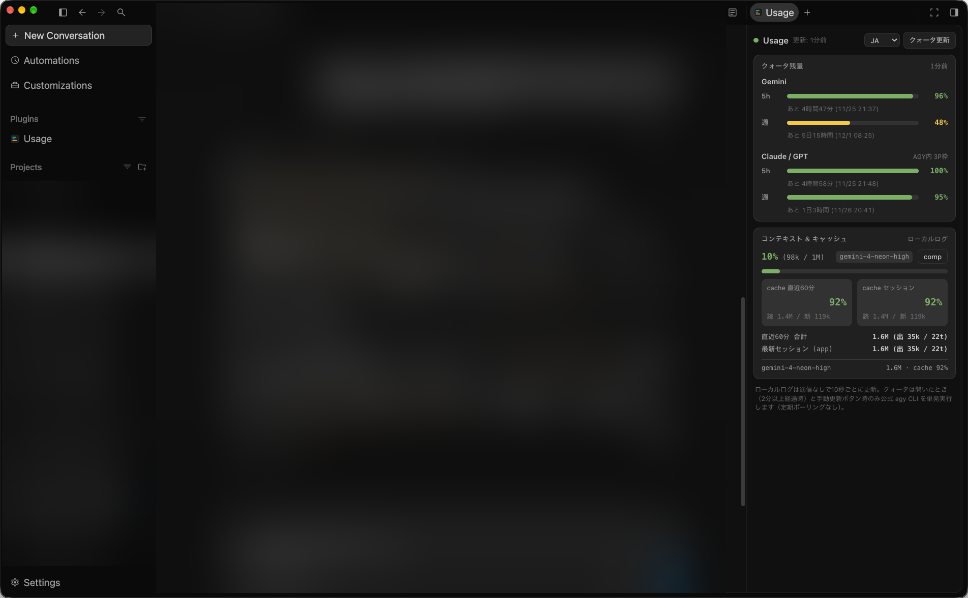

# Usage Monitor (`agy-usage-pane`)

[English](README.md)

Google Antigravity 向けの右サイドペイン / 左サイドバー用 Usage Monitor プラグイン（MCP App）です。5h・週次のクォータ残量と、オフライン集計のコンテキストサイズ・キャッシュヒット率・トークン使用量をひと目で確認できます。



## 主な機能

- **クォータ残量表示（5h / 週次）**: 公式 `agy` CLI（`agy --print /usage --output-format json`）を単発実行して、モデルグループ別の残量バーとリセットまでのカウントダウンを表示します。
  - 自動でのデータ取得（定期的なポーリング）は規約上の配慮からあえて行っていません。最新の現在値を確認するときは、画面内の「**クォータ更新**」（英語 UI では **Refresh**）ボタンを手動で実行してください（パネルを開いたときに前回取得から 2 分以上経過している場合のみ初回取得を行い、手動更新には 10 秒の連続更新クールダウンが付いています）。
- **ローカル使用量・キャッシュ集計（オフライン）**: `~/.gemini/antigravity/brain` と `~/.gemini/antigravity-cli/brain` の `transcript.jsonl` をローカルで読み取り、通信なしで 10 秒ごとに以下を集計・表示します。
  - 最新セッションのコンテキストサイズ推定とモデル名
  - 直近 60 分 / 最新セッションのキャッシュヒット率・トークン内訳・モデル別内訳
  - `/compact` 送信ボタン（ホストが `sendMessage` 機能を提供しているサイドペイン上のみ表示）
- **UI 言語切り替え（`Auto` / `JA` / `EN`）**: 既定（`Auto`）では Antigravity の `hostContext.locale`（未提供時はブラウザ環境ロケール、既定は `en`）および `hostContext.timeZone` に自動追従し、日本語・英語および日時表記を切り替えます。ヘッダーの言語セレクタから手動で `JA` / `EN` 固定または `Auto` へいつでも切り替えられ、選択は `${PLUGIN_DATA}/preferences.json` に永続化されます。

## 動作要件

- **Google Antigravity**（MCP Apps / `aux_pane`・`global` エントリポイント対応版）
- **Node.js 20 以上**（`PATH` 上で `node` が実行できること）
- **公式 `agy` CLI**（クォータ残量取得に使用。`ANTIGRAVITY_CLI_PATH` 環境変数、`~/.local/bin/agy`、`/opt/homebrew/bin/agy`、`/usr/local/bin/agy`、`PATH` の順で探索します）

前提確認コマンド:

```bash
node -v
agy --version
```

## インストール

バンドル済みの `dist/server.mjs` と `ui/dist/app.html` を同梱しているため、`npm install` なしでそのまま動きます。

Antigravity のプラグインディレクトリへ直接クローンする場合:

```bash
git clone https://github.com/mlabo-org/agy-usage-pane.git ~/.gemini/config/plugins/agy-usage-pane
```

別の場所へクローンして symlink で配置する場合:

```bash
git clone https://github.com/mlabo-org/agy-usage-pane.git ~/plugins/agy-usage-pane
ln -s ~/plugins/agy-usage-pane ~/.gemini/config/plugins/agy-usage-pane
```

配置後、Antigravity の右サイドペインの `+` メニューまたは左サイドバーの **Plugins** に **Usage** が表示されます。

## 開発・ビルド

ソース（`server/` や `ui/`）を変更した場合はバンドルを再生成します。

```bash
npm install
npm run build
```

- `npm run build:ui`: `ui/app.ts`・`ui/i18n.ts`・`ui/index.html` から単一 HTML `ui/dist/app.html` を生成
- `npm run build:server`: `server/index.mjs` 一式を単一 ESM バンドル `dist/server.mjs` に生成

## 既知の制限・注意点

- Antigravity のローカルログ（`transcript.jsonl` の `PLANNER_RESPONSE` 行）および `agy --print /usage --output-format json` の出力スキーマに依存しているため、Antigravity 本体の仕様変更により動作しなくなる場合があります。
- コンテキスト使用率は 1,000,000 トークンを基準に算出しています（200k 上限のモデルなどでは割合が低く表示されます）。
- `Auto` モードでは Antigravity の `hostContext.locale` を最優先に追従するため、Antigravity 本体が多言語対応していない環境では英語（またはホストが渡すロケール）になる場合があります。必要に応じてヘッダーの言語セレクタから `JA` / `EN` に手動切り替えできます。
- セッションログ内に `cwd=<path>` 行が記録されている環境では、そのディレクトリの Git ブランチ・変更件数も表示します（記録がない環境では非表示になります）。
- 外部へのテレメトリ送信や非公開エンドポイントへのアクセスは行いません。クォータキャッシュ（`${PLUGIN_DATA}/quota-cache.json`）および UI 言語設定（`${PLUGIN_DATA}/preferences.json`）はプラグインデータ領域にのみ保存されます。

## ライセンス

[MIT](LICENSE)
