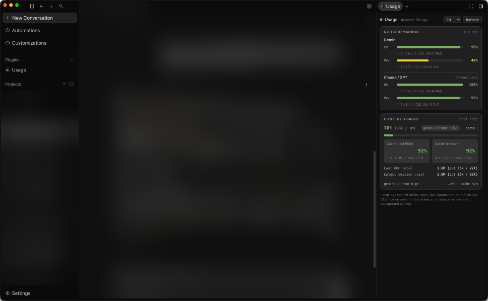

# Usage Monitor (`agy-usage-pane`)

[日本語](README.ja.md)

A compact Usage Monitor plugin (MCP App) for Google Antigravity's right side pane and left sidebar. It tracks 5h/weekly model quotas alongside offline local token usage, context size, and cache hit rates.



## Features

- **5h & Weekly Quota Balances**: Runs the official `agy` CLI (`agy --print /usage --output-format json`) on demand to display per-model-group remaining bars and reset countdowns.
  - Automatic background polling is intentionally omitted out of respect for the service terms. To check your latest quota balances, manually click the **Refresh** button (**クォータ更新** in Japanese UI) inside the panel (an initial fetch runs once on panel open only if cached data is older than 2 minutes, and manual refreshes have a 10-second cooldown).
- **Offline Local Usage & Cache Stats**: Reads local `transcript.jsonl` logs under `~/.gemini/antigravity/brain` and `~/.gemini/antigravity-cli/brain` every 10 seconds with zero network calls:
  - Estimated context size and active model for the latest session
  - Cache hit rate, token breakdown, and per-model summary (last 60 minutes and latest session)
  - `/compact` shortcut button (shown only on surfaces where the host supports `sendMessage`, such as the conversation side pane)
- **Bilingual UI (`Auto` / `JA` / `EN`)**: Defaults to `Auto`, following Antigravity's `hostContext.locale` (falling back to browser locale, then `en`) and `hostContext.timeZone`. Switch manually between `Auto`, `JA`, and `EN` from the header selector; your choice is persisted to `${PLUGIN_DATA}/preferences.json`.

## Requirements

- **Google Antigravity** with MCP Apps support (`aux_pane` and `global` entrypoints)
- **Node.js 20+** available as `node` in `PATH`
- **Official `agy` CLI** for quota lookups (searched in order: `ANTIGRAVITY_CLI_PATH`, `~/.local/bin/agy`, `/opt/homebrew/bin/agy`, `/usr/local/bin/agy`, `PATH`)

Verify prerequisites:

```bash
node -v
agy --version
```

## Installation

Prebuilt bundles (`dist/server.mjs` and `ui/dist/app.html`) are included in the repository, so no `npm install` step is required.

Clone directly into Antigravity's plugins directory:

```bash
git clone https://github.com/mlabo-org/agy-usage-pane.git ~/.gemini/config/plugins/agy-usage-pane
```

Or clone elsewhere and symlink it:

```bash
git clone https://github.com/mlabo-org/agy-usage-pane.git ~/plugins/agy-usage-pane
ln -s ~/plugins/agy-usage-pane ~/.gemini/config/plugins/agy-usage-pane
```

After installation, **Usage** appears in Antigravity's right side-pane `+` menu and in the left sidebar under **Plugins**.

## Development & Build

If you edit files under `server/` or `ui/`, rebuild the tracked bundles:

```bash
npm install
npm run build
```

- `npm run build:ui`: Bundles `ui/app.ts`, `ui/i18n.ts`, and `ui/index.html` into a single self-contained `ui/dist/app.html`
- `npm run build:server`: Bundles `server/index.mjs` and its dependencies into a single ESM file `dist/server.mjs`

## Known Limitations & Privacy Notes

- Depends on Antigravity's local `transcript.jsonl` (`PLANNER_RESPONSE` rows) and the JSON output schema of `agy --print /usage --output-format json`; upstream Antigravity changes may require updates.
- Context utilization percentage is calculated against an assumed 1,000,000-token window (models with smaller windows will display a lower percentage).
- In `Auto` mode, the UI prioritizes `hostContext.locale` so it follows Antigravity's locale automatically as host localization evolves. On hosts that always report English, use the header selector to pick `JA` or `EN` explicitly.
- When a session log records a `cwd=<path>` line, the panel also displays that directory's Git branch and modified-file count; otherwise the Git row is omitted.
- No external telemetry or undocumented endpoints are used. Quota cache (`${PLUGIN_DATA}/quota-cache.json`) and UI preferences (`${PLUGIN_DATA}/preferences.json`) are stored locally in the plugin data directory only.

## License

[MIT](LICENSE)
